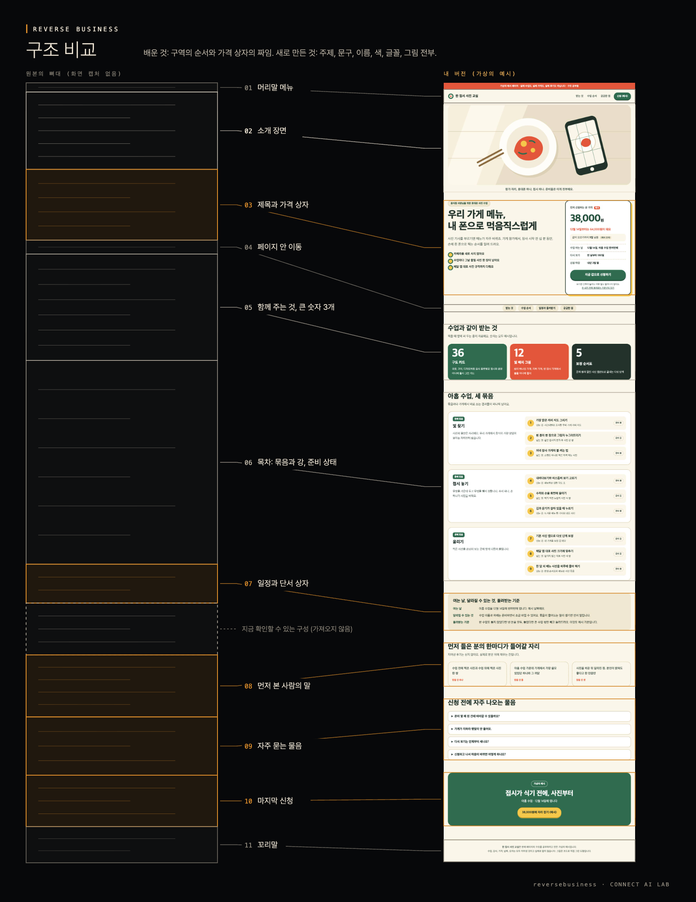

# 대표 예시: 공개 판매 페이지 한 장을 해부하고 내 버전까지

대상은 CONNECT AI LAB 이 운영하는 [aicitybuilders.com](https://www.aicitybuilders.com) 의 공개 판매 페이지 한 장입니다. 채널 주인 본인의 페이지를, 남의 서비스와 똑같은 방식으로 밖에서 보이는 것만 읽었습니다 (공개 주소 4개, 로그인과 결제 0).

가격과 날짜는 모두 **2026-11-17 에 읽은 값**입니다. 지금의 페이지와 다를 수 있습니다.



왼쪽은 원본의 뼈대(선으로만 그린 구역), 오른쪽은 구조만 배워 새로 만든 내 버전입니다. 내 버전은 가상의 다른 주제(휴대폰 음식 사진 수업)이고 화면에 예시라고 적혀 있습니다.

## 들어 있는 것

| 파일 | 무엇인가 |
|---|---|
| `report.json` | 6칸 리포트. 문장 33개 가운데 관찰 20, 추정 6, 모름 7. 근거 10개, 따로 정리한 모르는 것 7건. 수익 숫자 칸은 비어 있습니다 |
| `report.html` | 한 파일짜리 해부 화면. 내려받아 더블클릭하면 인터넷 없이 열립니다 |
| `report.draft.json` | REA 근거에서 자동으로 만든 초안의 공개용 사본. 원본 제목과 버튼의 목록은 개수만 남겼습니다 |
| `my-version/` | 리포트 6번 칸의 명세만 보고 새로 쓴 한 장 (HTML 과 CSS, 바깥 자원 없음) |
| `my-version.preview.jpg`, `my-version.preview.json` | 내 버전을 찍은 그림과 구역 위치. 해부 화면의 영상 저장이 씁니다 |
| `structure-compare.png` | 위의 구조 비교 그림 |
| `command-log.md` | REA 로 읽을 때 실제로 돌린 명령과 막힌 곳 |

## 들어 있지 않은 것

원본 페이지의 화면 캡처, 받아 둔 HTML, REA 기록, 원본 글 묶음(`source.json`)은 공개 저장소에 올리지 않았습니다. 리포트의 근거 장부에 적힌 `evidence/...` 경로는 그 파일들을 가리키며, 분석한 사람의 컴퓨터에만 있습니다.

## 다시 열어 보기

```bash
npx github:smeagemoeny-maker/reversebusiness demo
# 저장소를 받아 둔 경우
node bin/rebiz.mjs view examples/aicitybuilders-vibecoding/report.json --mine examples/aicitybuilders-vibecoding/my-version
node bin/rebiz.mjs check examples/aicitybuilders-vibecoding/report.json
```
